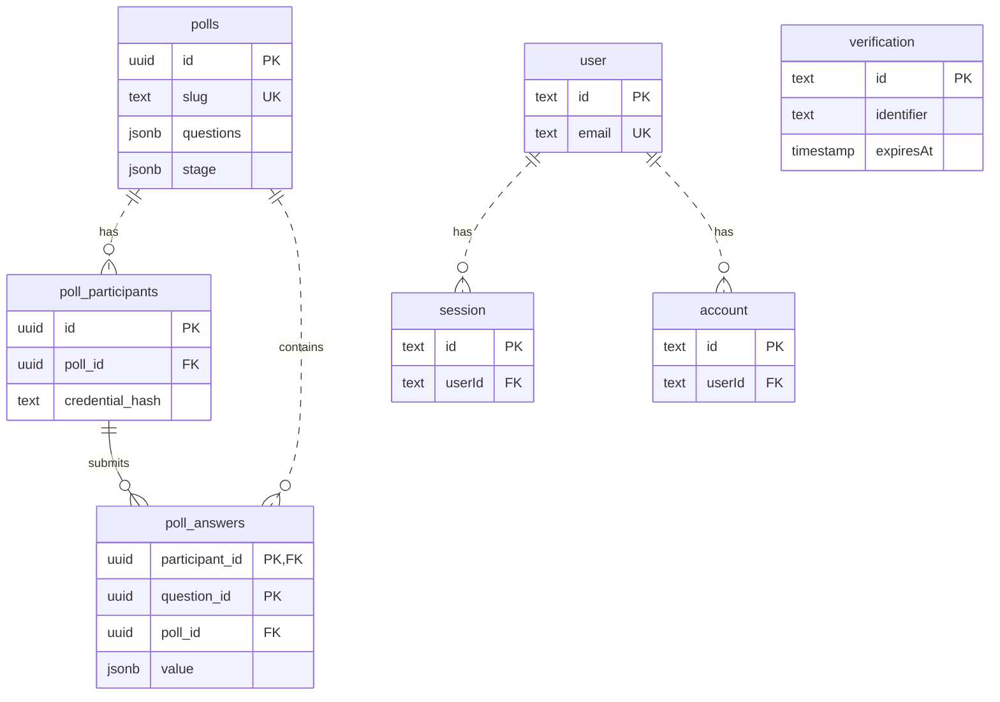

# Data model

This document describes the implemented v1 polling application. The database
stores poll definitions, participation, accepted answers and organizer
authentication. Results are calculated from accepted answers; unfinished
participant drafts stay in the browser.

## Entities and relationships



The diagram shows physical foreign-key relationships. Questions are embedded
objects, not a separate table. `verification` has no foreign key. Polls have no
organizer/user foreign key: v1 authorizes one configured organizer across all
polls, rather than storing ownership per poll. Participants are independent of
authentication users, including when check-in collects an email address.

## Poll definitions: `polls`

One row represents one poll and its current authoritative session state.

| Column          | SQL type    | Meaning and constraints                                                                                                                      |
| --------------- | ----------- | -------------------------------------------------------------------------------------------------------------------------------------------- |
| `id`            | `uuid`      | Primary key; database-generated UUID. Used for organizer operations.                                                                         |
| `slug`          | `text`      | Required and unique; application generates 16 random bytes as 32 hexadecimal characters. Used in participant and projector links.            |
| `title`         | `text`      | Required column; application limit 200 characters. A Draft may have an empty title.                                                          |
| `mode`          | `text`      | Required; application accepts `async` or `live`.                                                                                             |
| `participation` | `text`      | Required; application accepts `anonymous` or `check-in`.                                                                                     |
| `show_results`  | `boolean`   | Required, defaults to `false`. Allows completed asynchronous participants to see combined results; live visibility follows the reveal stage. |
| `status`        | `text`      | Required, defaults to `draft`; lifecycle is `draft` → `open` → `closed`.                                                                     |
| `questions`     | `jsonb`     | Required ordered array of question definitions; shape described below.                                                                       |
| `stage`         | `jsonb`     | Required; defaults to `{"kind":"waiting"}`. Holds the current live stage. Closing either mode stores `{"kind":"ended"}`.                     |
| `revision`      | `integer`   | Required, defaults to `0`. Increments on definition, lifecycle or live-stage changes; joining and answering do not increment it.             |
| `created_at`    | `timestamp` | Required; defaults to database `now()`.                                                                                                      |

### Embedded questions

Array position defines presentation order. Each question has a UUID used to
associate its answers and live stage. Draft edits preserve supplied question IDs;
new questions receive generated IDs.

```json
[
  {
    "id": "6bb76538-0493-4aad-86db-f3f1c78c82f",
    "prompt": "Which topic should we cover next?",
    "type": "choice",
    "choices": ["Build", "Test"]
  }
]
```

| Property  | Application type and rule                                                                                                                                                                       |
| --------- | ----------------------------------------------------------------------------------------------------------------------------------------------------------------------------------------------- |
| `id`      | UUID string; distinct within the poll.                                                                                                                                                          |
| `prompt`  | String, at most 1,000 characters; nonblank when opening.                                                                                                                                        |
| `type`    | `text`, `number` or `choice`.                                                                                                                                                                   |
| `choices` | String array. Choice questions require 2–10 nonblank labels when opening, each at most 200 characters and distinct after trimming and ignoring case. Other question types store an empty array. |

Drafts may be incomplete and contain zero questions. Opening requires a nonblank
title and 1–10 valid questions. Questions and settings freeze once opened, so a
choice answer can safely store its exact choice label instead of a choice ID.

### Live stage

| Stored `stage`                                | Meaning                                                                                                                 |
| --------------------------------------------- | ----------------------------------------------------------------------------------------------------------------------- |
| `{"kind":"waiting"}`                          | Poll is waiting for the organizer to open its first question. Also the initial value for Drafts and asynchronous polls. |
| `{"kind":"question","questionId":"…"}`        | That live question accepts new answers.                                                                                 |
| `{"kind":"question-closed","questionId":"…"}` | Answering has stopped; results are not shared.                                                                          |
| `{"kind":"reveal","questionId":"…"}`          | Results for that question are shared.                                                                                   |
| `{"kind":"ended"}`                            | Poll is closed permanently.                                                                                             |

The organizer advances questions in array order. A closed question cannot reopen;
the organizer may reveal its results or skip directly to the next question.
Live commands carry the displayed `revision`; a stale command is rejected.
Asynchronous answering uses `status`, not the live question sequence.

## Browser participation: `poll_participants`

One row represents one browser's participation in one poll, not a verified person
or a login account. A browser can have separate participation in different polls.

| Column            | SQL type              | Meaning and constraints                                                                                                                            |
| ----------------- | --------------------- | -------------------------------------------------------------------------------------------------------------------------------------------------- |
| `id`              | `uuid`                | Primary key; database-generated UUID.                                                                                                              |
| `poll_id`         | `uuid`                | Required foreign key to `polls.id`; deleting the poll cascades to this row.                                                                        |
| `credential_hash` | `text`                | Required SHA-256 hex digest of the browser's random poll credential. Unique together with `poll_id`.                                               |
| `name`            | `text`, nullable      | Check-in name; application requires 1–200 trimmed characters for check-in polls. Anonymous participation stores `NULL`.                            |
| `email`           | `text`, nullable      | Formatted check-in email, at most 320 characters. Anonymous participation stores `NULL`. No uniqueness constraint or email-ownership verification. |
| `completed_at`    | `timestamp`, nullable | Set in the transaction accepting a complete asynchronous submission. Remains `NULL` before that submission and throughout live participation.      |

The browser keeps a random 32-byte credential in a poll-specific HttpOnly cookie;
the database stores only its hash. The unique index
`poll_participants_browser_unique (poll_id, credential_hash)` prevents duplicate
participation for the same credential. Clearing cookies or using another browser
can create another participation, including with the same check-in email.

Joining an Open poll creates the row. Reading a poll or opening its presentation
view does not. Existing check-in information is reused rather than changed on
rejoin. Check-in identifies responses to the organizer; it grants no organizer
permissions and does not create a `user` row.

## Accepted responses: `poll_answers`

One row represents one accepted answer from one participant to one question.

| Column           | SQL type | Meaning and constraints                                                                                                   |
| ---------------- | -------- | ------------------------------------------------------------------------------------------------------------------------- |
| `poll_id`        | `uuid`   | Required foreign key to `polls.id`, with cascading deletion.                                                              |
| `participant_id` | `uuid`   | Required foreign key to `poll_participants.id`, with cascading deletion; part of the primary key.                         |
| `question_id`    | `uuid`   | Required; part of the primary key. Refers logically to a question embedded in `polls.questions`, with no SQL foreign key. |
| `value`          | `jsonb`  | Required JSON string or number, validated against the question type.                                                      |

The composite primary key `(participant_id, question_id)` permits one accepted
answer per participant/question. There is no separate answer ID or answer
timestamp column.

| Question type | Stored answer                                | Validation                                                                                                   |
| ------------- | -------------------------------------------- | ------------------------------------------------------------------------------------------------------------ |
| `text`        | JSON string, e.g. `"More examples, please."` | Nonblank, at most 2,000 characters; original text is retained.                                               |
| `number`      | JSON number, e.g. `-2.5`                     | One finite number; numeric input strings are converted to numbers. Zero, negatives and decimals are allowed. |
| `choice`      | JSON string, e.g. `"Build"`                  | Exactly one label from that question's frozen `choices`.                                                     |

Asynchronous submission validates every question, inserts all answers and sets
`completed_at` in one transaction. Partial submissions are not accepted. Live
submission inserts one answer for the currently open question and does not set
`completed_at`; a live participant can therefore have answers without being
marked as an asynchronous completion.

Accepted answers cannot be edited. An identical retry recovers acceptance even
after closure or advancement; a conflicting retry is rejected. These semantics
are implemented in the DAL, in addition to the database uniqueness constraint.

## Organizer authentication

Better Auth owns four separate tables. Their identifiers are SQL `text`, even
though organizer provisioning generates UUID strings. Auth columns retain
Better Auth's camelCase names.

| Table          | Fields and purpose                                                                                                                                                                                                                                        | Relationships and indexes                                                                                           |
| -------------- | --------------------------------------------------------------------------------------------------------------------------------------------------------------------------------------------------------------------------------------------------------- | ------------------------------------------------------------------------------------------------------------------- |
| `user`         | `id`, `name`, `email`, `emailVerified`, optional `image`, `createdAt`, `updatedAt`. Represents the organizer's login identity.                                                                                                                            | Primary key `id`; unique required `email`.                                                                          |
| `account`      | `id`, `accountId`, `providerId`, `userId`, optional `password` and OAuth fields, `createdAt`, `updatedAt`. In v1, provisioning creates a `credential` account whose `password` contains a Better Auth password hash and whose `accountId` is the user ID. | Primary key `id`; required indexed `userId` references `user.id`, with cascading deletion.                          |
| `session`      | `id`, `token`, `userId`, `expiresAt`, `createdAt`, `updatedAt`, optional `ipAddress` and `userAgent`. Stores organizer login sessions.                                                                                                                    | Primary key `id`; unique required `token`; required indexed `userId` references `user.id`, with cascading deletion. |
| `verification` | `id`, `identifier`, `value`, `expiresAt`, `createdAt`, `updatedAt`. Stores transient authentication verification/recovery records managed by Better Auth.                                                                                                 | Primary key `id`; nonunique index on `identifier`; no foreign key to `user`.                                        |

The retained OAuth columns on `account` are nullable `accessToken`, `refreshToken`,
`idToken`, `scope`, `accessTokenExpiresAt` and `refreshTokenExpiresAt`. Social
providers and public registration are disabled in v1.

`ORGANIZER_EMAIL` configuration selects the account permitted to administer
polls. There is no role, organization, membership or poll-ownership table.
Provisioning atomically creates the user and credential account if absent and
never replaces an existing password. Recovery changes that credential through
Better Auth and revokes existing sessions. Participant check-in and the
organizer's auth-session metadata are separate data concerns.

## Integrity, deletion and derived views

The database enforces primary keys, foreign keys, required columns and the unique
keys described above. Domain rules are enforced by validation and the DAL:

- `mode`, `participation` and `status` are SQL text, not database enums. JSONB
  shapes, allowed values, content limits and legal transitions have no SQL
  `CHECK` constraints in the current schema.
- The DAL verifies that an answer's participant and embedded question belong to
  its poll. The separate `poll_id` and `participant_id` foreign keys alone do not
  enforce that pairing, and `question_id` has no physical question table.
- Mutations lock the poll row within a transaction. Submission, closure, deletion
  and live controls serialize across application processes; a new submission
  after closure cannot be accepted. Consistent snapshot reads use a shared lock.
- Deleting a poll cascades to its participants and answers. Duplicating copies
  only its title, questions and settings into a fresh Draft with new poll,
  question and link identifiers; participation and answers are not copied.

Results and permissions are derived, not separate tables. Choice results contain
counts and percentages, number results contain count and average (`null` when
empty), and text results contain accepted strings. Async aggregates include only
completed submissions; live aggregates include accepted answers to each question.

| Audience    | Derived view                                                                                                                                                                                                                                                              |
| ----------- | ------------------------------------------------------------------------------------------------------------------------------------------------------------------------------------------------------------------------------------------------------------------------- |
| Organizer   | Full definition, participant/completion counts, results and response associations, including check-in details when supplied. Browser credential hashes are not returned.                                                                                                  |
| Participant | Permitted questions, current stage, own accepted question IDs and completion state. Async results require that browser's completed submission plus `show_results`; live results require the current reveal stage. No check-in identities or participant IDs are returned. |
| Projector   | Joining information, live state, current question and response count; results only during reveal. No organizer controls or check-in identities; reading creates no participation.                                                                                         |

## Data outside these tables

| Data                                                  | Storage and lifetime                                                                                                                                                        |
| ----------------------------------------------------- | --------------------------------------------------------------------------------------------------------------------------------------------------------------------------- |
| Unfinished asynchronous answers                       | Browser `localStorage`, under `pulse-draft:<slug>`, as a question-ID-to-answer object. They never contribute to server results and are cleared after successful submission. |
| Raw participant credential                            | Browser HttpOnly cookie. Only its hash is sent to the DAL and stored in `poll_participants`.                                                                                |
| Share URL and QR image                                | Generated from the canonical application origin and poll slug; no share or QR table.                                                                                        |
| Organizer identity configuration and provider secrets | Environment configuration, not poll or participant rows.                                                                                                                    |

Database deletion does not proactively clear browser storage or erase retained
database backups.
